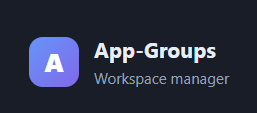
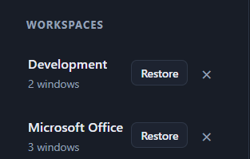
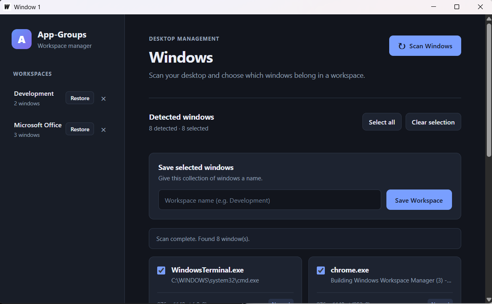

# App-Groups

{width="500"}

## What is App Groups?

App Groups is a Windows desktop application that allows users to save and restore groups of open applications and their window layouts.

It captures the state of selected application windows, including positioning and dimensions. A workspace can be named and saved, then to be restored at any time, automatically reopening applications in the same state as they were when the workspace was created.

## Features
- Window Detection: Detects all currently open windows.
- Window Selection: Allows users to choose which windows to save to a workspace.
- Persistent Storage: Stores workspaces locally in JSON.
- Workspace Restoration: Reopens applications and restores their saved window positions, dimensions, and states.
- Workspace Management: Allows users to view and delete saved workspaces.

## Technology
  App Groups is built using Go and Wails v3, with a JavaScript-based frontend.
  
- Go: Backend logic, window detection, and workspace persistence.
- Wails v3: Desktop application framework.
- JavaScript: Frontend interface and user interaction.
- JSON: Workspace configuration and persistence.

## Requirements

| 	|Version|
| -  	| -	|
| Windows| 10/11|
| Go 	| 1.26.0|
| Wails | 3.0.0 |
|Node.js|	|
| npm	|	|

## Build from source

```
#Clone the Repository:

git clone https://github.com/roycenogales/App-Groups.git

#Navigate to the project directory:

cd App-Groups

#Build the application:

wails3 build

#the compiled application will be available in 'build/bin/'.
```

## Known Limitations

## Contributors
Royce Nogales [github.com/roycenogales]

### License
MIT

### References


{width="50%"}